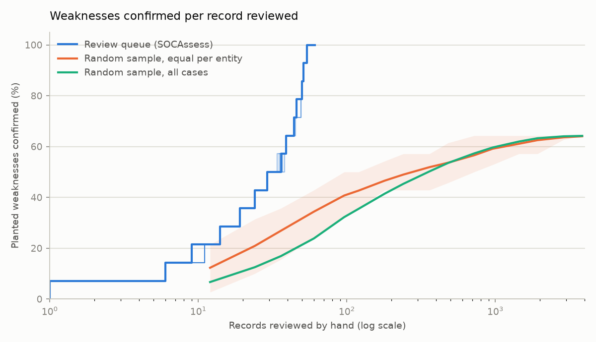
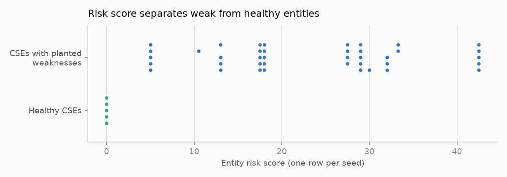

# Validation report

Generated by `python scripts/validate.py` on 2026-11-09 04:42 UTC.
Seeds: 7, 11, 23, 42, 99. Each seed is a fresh synthetic world of 12 CSEs (4 healthy, 8 with 1–3 planted
weaknesses; 14 planted weaknesses per seed), run through the full pipeline:
generate → ingest (CSV/JSON/SQLite) → analyse with the **default parameters** (no per-seed tuning) → compare with
the ground truth. Seed 7 is the dataset the parameters were developed on; **the other seeds are held-out data.**

## Headline

| | Result (all 5 seeds) |
|---|---|
| Planted weaknesses detected (recall) | **70/70 = 100.0%** |
| Findings of a planted type that were wrong (precision) | **70/70 = 100.0%** |
| Healthy entities with any finding (false alarms) | 0/20 |
| Risk-score ranking, weak vs healthy (AUC) | 1.00 |
| Records to review to confirm every weakness (queue) | 54 on average (≈ 4.5 analyst-hours at 5 min/record) |

## Per seed

| Seed | Detected | Wrong-type FP | Precision | Recall | Evidence precision | Evidence recall | AUC | Healthy flagged | Analysis time |
|---|---|---|---|---|---|---|---|---|---|
| 7 | 14/14 | 0 | 100.0% | 100.0% | 99.4% | 99.8% | 1.00 | 0/4 | 41s |
| 11 | 14/14 | 0 | 100.0% | 100.0% | 99.4% | 100.0% | 1.00 | 0/4 | 16s |
| 23 | 14/14 | 0 | 100.0% | 100.0% | 99.1% | 99.9% | 1.00 | 0/4 | 45s |
| 42 | 14/14 | 0 | 100.0% | 100.0% | 99.2% | 100.0% | 1.00 | 0/4 | 26s |
| 99 | 14/14 | 0 | 100.0% | 100.0% | 99.0% | 100.0% | 1.00 | 0/4 | 30s |

## Per weakness type (all seeds)

| Type | Planted | Detected | False positives | Precision | Recall |
|---|---|---|---|---|---|
| critical_no_escalation | 5 | 5 | 0 | 100.0% | 100.0% |
| fast_closure | 10 | 10 | 0 | 100.0% | 100.0% |
| low_activity | 5 | 5 | 0 | 100.0% | 100.0% |
| missing_categories | 10 | 10 | 0 | 100.0% | 100.0% |
| missing_records | 5 | 5 | 0 | 100.0% | 100.0% |
| repeated_no_remediation | 5 | 5 | 0 | 100.0% | 100.0% |
| silent_critical_assets | 10 | 10 | 0 | 100.0% | 100.0% |
| sla_gaming | 10 | 10 | 0 | 100.0% | 100.0% |
| template_notes | 10 | 10 | 0 | 100.0% | 100.0% |

### Evidence quality (record level, detected weaknesses with record evidence)

`found` = records the finding cites, `planted` = records the generator planted, `overlap` = both.

| Type | Planted records | Found records | Overlap | Precision | Recall |
|---|---|---|---|---|---|
| critical_no_escalation | 544 | 549 | 544 | 99.1% | 100.0% |
| fast_closure | 9008 | 9094 | 9008 | 99.1% | 100.0% |
| missing_categories | 15 | 15 | 15 | 100.0% | 100.0% |
| missing_records | 1654 | 1654 | 1654 | 100.0% | 100.0% |
| repeated_no_remediation | 662 | 674 | 648 | 96.1% | 97.9% |
| silent_critical_assets | 44 | 44 | 44 | 100.0% | 100.0% |
| sla_gaming | 5559 | 5661 | 5559 | 98.2% | 100.0% |
| template_notes | 10422 | 10422 | 10422 | 100.0% | 100.0% |

Evidence precision below 100% means the finding also cites records that meet the detector's rule but were
not planted. Healthy entities also contain some naturally fast closures and unescalated critical cases, so
these are true rule matches, not errors.

## Misses and false alarms

- Missed weaknesses: none.
- Findings of a planted type on the wrong entity: none.
- Any finding on a healthy entity: none.

## Tool vs manual sampling

A supervisor who checks randomly sampled case records confirms a weakness only when one of the sampled
records is planted evidence. The review queue instead puts the strongest evidence for each finding
first. A weakness counts as confirmed only when the reviewed record really is planted evidence (or is a
finding-level item for something that is missing).

| Approach | Records reviewed | Weaknesses confirmed | Analyst time |
|---|---|---|---|
| Review queue (SOCAssess) | 54 | 100.0% | 4.5 h |
| Random sample, equal per entity, same budget | 54 | 32.5% | 4.5 h |
| Random sample, all cases, same budget | 54 | 22.1% | 4.5 h |
| Random sample, equal per entity, 3,840 records | 3,840 | 64.0% | 320 h |

Random case sampling has a ceiling: weaknesses that leave **no case record** (silent critical assets, missing
alert categories, abnormally low activity, alerts that never got a case) can never be found by sampling cases,
however many are reviewed. Those need the cross-entity, negative-space comparison the tool makes. The
time figures assume 5 minutes per record and leave out the tool's own runtime (under a minute, unattended).

## Method notes and limits
- The data is synthetic and the planted weaknesses are deliberately clear-cut. Real SOC data is noisier, so
  these numbers are an upper bound on what to expect, not a field measurement.
- Healthy entities include realistic noise (some fast closures, unescalated true positives, SLA breaches,
  open cases), so the detectors cannot rely on clean baselines.
- Thresholds were set once on seed 7 and kept fixed. The other seeds measure how well they generalise.
- The random baseline is a Monte Carlo average (200 repetitions per budget); the shaded band in
  the chart is its 10th–90th percentile.
- Raw results: `data/processed/validation/results.json`.
